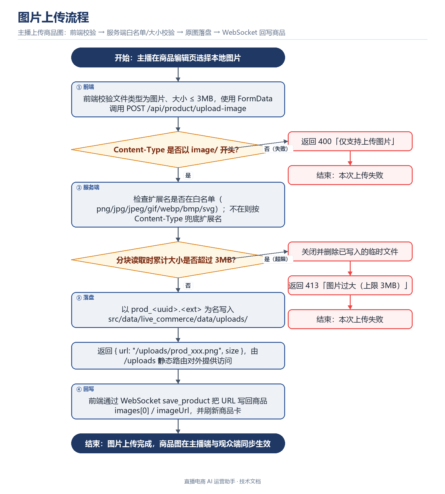
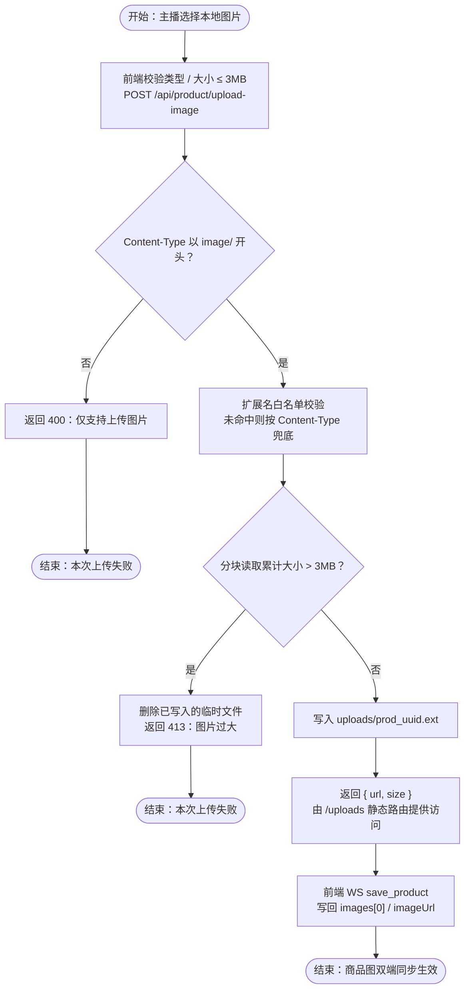
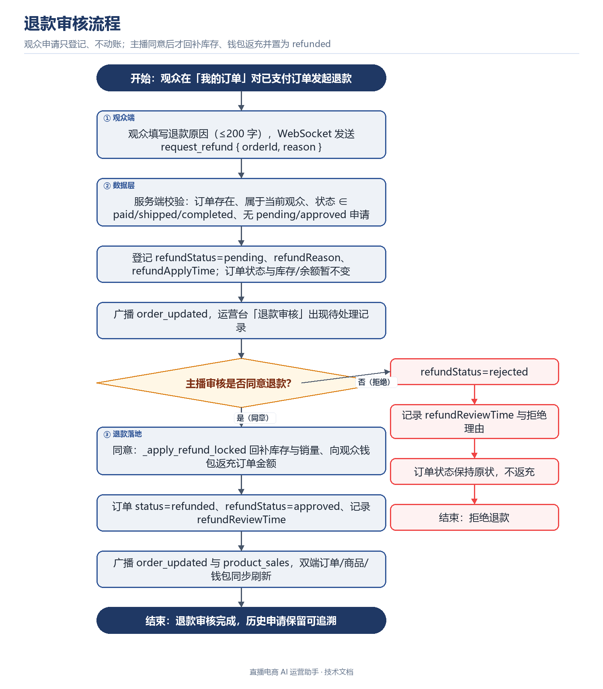
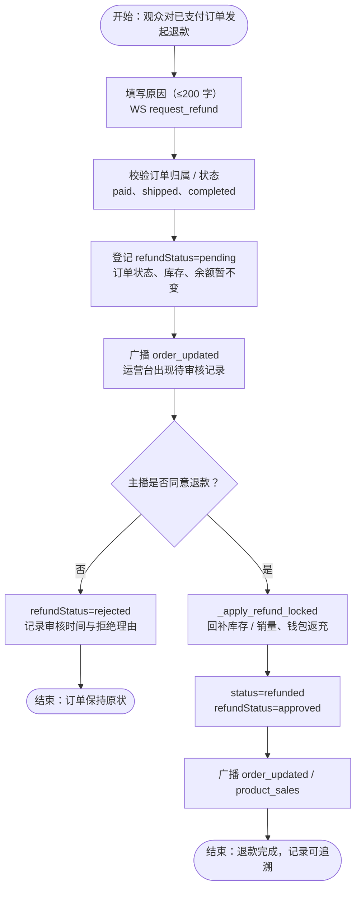
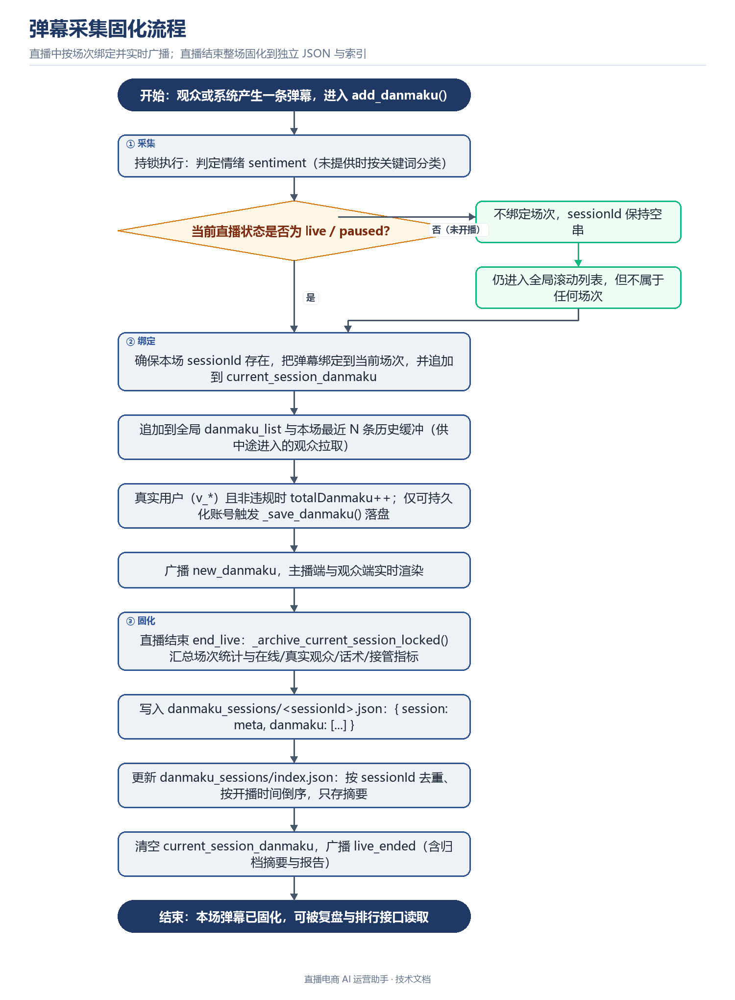
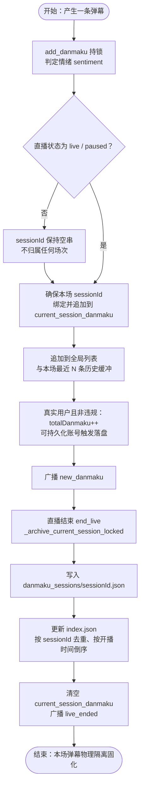
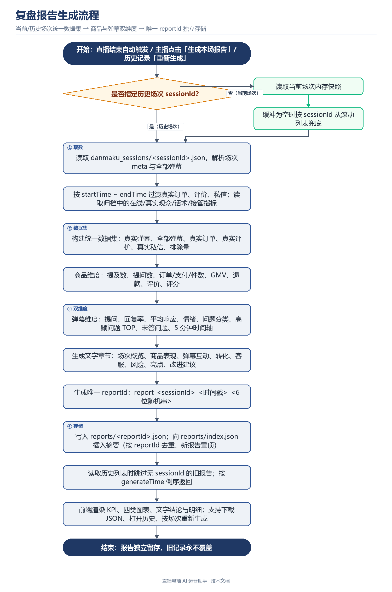
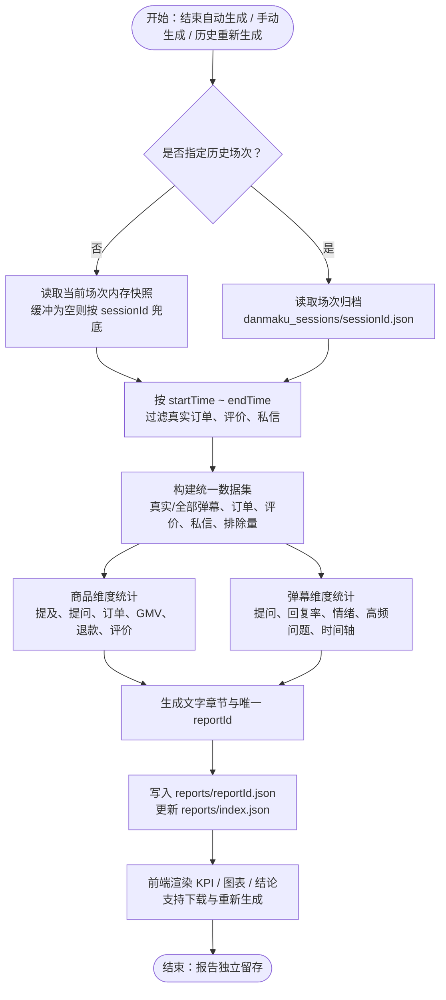

# 业务流程图

本文档给出直播电商 AI 运营助手的四条关键业务链路：**图片上传、退款审核、弹幕采集固化、复盘报告生成**。每条链路同时提供：

- 可直接渲染的 Mermaid 源码（便于在 GitHub / Typora / VS Code 中查看与修改）；
- 导出的 PNG 图片（位于 `docs/images/`，用于 Word / PDF 提交材料）；
- 关键步骤说明、异常分支与对应源码位置。

> 图片由 `scripts/generate_flowcharts.py` 使用 Pillow 生成，不依赖 Graphviz 或 Mermaid CLI。修改流程图后执行：
>
> ```bash
> .venv/Scripts/python.exe scripts/generate_flowcharts.py
> ```

## 流程索引

| 流程 | PNG | 核心入口 | 数据落点 |
| --- | --- | --- | --- |
| 图片上传 | `images/flow_image_upload.png` | `POST /api/product/upload-image` | `src/data/live_commerce/data/uploads/` |
| 退款审核 | `images/flow_refund_review.png` | WS `request_refund` / `review_refund` | `orders.json`、观众钱包、商品库存 |
| 弹幕采集固化 | `images/flow_danmaku_archive.png` | `add_danmaku()` / `end_live()` | `danmaku_sessions/<sessionId>.json`、`index.json` |
| 复盘报告生成 | `images/flow_report_generation.png` | `generate_report()` | `reports/<reportId>.json`、`reports/index.json` |

图中统一约定：深蓝胶囊为开始 / 结束，浅蓝圆角框为处理步骤，橙色菱形为判断，绿色为可继续的旁路，红色为失败或拒绝分支。

---

## 一、图片上传流程

主播在商品编辑页选择本地图片，前端以 `multipart/form-data` 上传；服务端只做类型、扩展名与大小校验，**保留原图**写入本地上传目录，返回相对 URL，再由前端通过 WebSocket `save_product` 写回商品。



### Mermaid 源码



### 关键步骤

1. **前端预校验**：`accept="image/*"` 限制文件选择器；提交前检查 `file.type.startsWith('image/')` 与 `file.size <= 3 * 1024 * 1024`，避免明显不合法的请求占用带宽。
2. **服务端类型校验**：`content_type` 必须以 `image/` 开头，否则返回 `400`（`upload_routes.py:27-29`）。
3. **扩展名白名单**：允许 `.png/.jpg/.jpeg/.gif/.webp/.bmp/.svg`；文件名缺失或扩展名不在白名单时，按 `Content-Type` 兜底，仍无法识别则用 `.png`（`upload_routes.py:31-40`）。
4. **流式落盘与限额**：以 `256KB` 分块读取，累计超过 `3MB` 立即关闭文件、删除半成品并返回 `413`，不会把超大文件留在磁盘（`upload_routes.py:46-60`）。
5. **文件命名**：`prod_<uuid4hex><ext>`，避免同名覆盖与路径穿越；头像上传复用同一函数，前缀为 `av`。
6. **访问方式**：`service.py` 将上传目录挂载为 `/uploads` 静态路由；前端只保存相对 URL，部署域名变化时无需改库。
7. **回写商品**：拿到 URL 后通过 WebSocket `save_product` 更新商品 `images[0]` 与 `imageUrl`，服务端广播 `product_updated`，主播端与观众端同时刷新（`live_commerce_ws.py:750-769`）。

### 边界与异常

| 场景 | 行为 |
| --- | --- |
| 非图片 MIME | `400 仅支持上传图片` |
| 超过 3MB | 删除临时文件，`413 图片过大（上限 3MB）` |
| 扩展名伪造 | 按 `Content-Type` 兜底，不信任原始文件名 |
| 上传成功但未保存商品 | 图片文件已落盘，但不进入商品数据；可在后续编辑中重新选择 |
| 并发同名 | UUID 命名，天然不冲突 |

---

## 二、退款审核流程

退款采用**申请与执行分离**：观众提交申请只登记 `refundStatus=pending`，不改订单状态、不动库存与余额；主播审核同意后才执行退款落地，拒绝则只记录审核结果。



### Mermaid 源码



### 关键步骤

1. **提交入口**：观众端在「我的订单」填写原因后发送 WS `request_refund`，消息在观众白名单内（`live_commerce_ws.py:53`、`:1695-1702`）。
2. **资格校验**（`data_manager.py:2226-2237`）：
   - 订单必须存在；
   - `order.userId` 必须等于当前观众，防止越权退别人的订单；
   - 订单状态必须是 `paid / shipped / completed`；
   - 不能重复提交：已有 `pending` 或 `approved` 均拒绝。
3. **只登记、不动账**：写入 `refundStatus=pending`、`refundReason`、`refundApplyTime`，清空旧的拒绝理由；此时 `status`、库存、销量、钱包余额全部保持不变，避免待审核期间污染 GMV 与成交口径（`data_manager.py:2238-2243`）。
4. **主播审核**：`review_refund` 仅主播可达，要求 `refundStatus == pending`（`data_manager.py:2246-2259`）。
5. **同意退款**：`_apply_refund_locked` 在锁内完成三件事——回补商品库存、扣减销量、向观众钱包返充订单金额，并置 `status=refunded`、`refundStatus=approved`、记录 `refundReviewTime`（`data_manager.py:2200-2213`）。
6. **拒绝退款**：只置 `refundStatus=rejected`，记录审核时间与拒绝理由（截断 200 字），订单状态、库存、余额均不变（`data_manager.py:2262-2265`）。
7. **双端同步**：审核后统一广播 `order_updated`，并广播 `product_sales` 让商品销量/库存卡片刷新（`data_manager.py:2266-2268`）。

### 边界与异常

| 场景 | 返回 |
| --- | --- |
| 未填写原因 | `请填写退款原因` |
| 订单不存在 | `订单不存在` |
| 非本人订单 | `无权操作该订单` |
| 状态不支持（待支付 / 已取消 / 已退款） | `当前订单状态不支持退款` |
| 重复申请 | `退款申请正在审核中，请勿重复提交` |
| 已退款 | `该订单已退款` |
| 审核非 pending 申请 | `该订单没有待审核的退款申请` |

> 实现细节：`review_refund` 无论同意或拒绝都会广播 `product_sales`。这是为了让前端统一走一条刷新路径，避免拒绝分支漏刷新；商品数据本身只在同意分支被修改。

---

## 三、弹幕采集固化流程

弹幕在直播过程中按场次绑定、实时广播；直播结束时把整场弹幕与场次指标固化到独立 JSON 文件，并更新只含摘要的索引，供复盘与历史排行读取。



### Mermaid 源码



### 关键步骤

1. **持锁采集**：`add_danmaku` 在 `self._lock` 内完成情绪判定、场次绑定、全局列表与历史缓冲追加，保证并发弹幕不会跨场次串数据（`data_manager.py:1525-1544`）。
2. **情绪判定**：弹幕未携带 `sentiment` 时按关键词分类；后续场次统计与复盘直接复用该字段。
3. **场次绑定**（`data_manager.py:999-1012`）：
   - 仅 `live / paused` 状态采集；
   - `sessionId` 缺失时自动补一个 `live_年月日_时分秒_随机串`；
   - 只有弹幕的 `sessionId` 等于当前场次才追加到 `current_session_danmaku`。
4. **未开播弹幕**：`sessionId` 保持空串，仍进入全局滚动列表，但不属于任何场次，也不会被归档。
5. **实时缓冲**：全局 `danmaku_list` 供主播端统计/筛选；`live_danmaku_history` 只保留最近 `N` 条，供中途进入的观众拉取，不是审计日志。
6. **真实口径**：`totalDanmaku` 只统计 `v_*` 真实账号且非违规的弹幕；模拟账号（`virtual/mock`）不计入真实互动指标。
7. **按需落盘**：只有可持久化账号（真实账号或主播）才触发 `_save_danmaku()`，虚拟弹幕每秒生成，不能每条都写盘。
8. **结束归档**（`data_manager.py:1034-1095`）：
   - 汇总场次 meta：标题、商品、起止时间、时长、弹幕总数/真实数/提问数/情绪分布、真实观众数、峰值/平均在线、话术使用数、人工接管数；
   - 写 `danmaku_sessions/<sessionId>.json`：`{ session: meta, danmaku: [...] }`；
   - 写 `danmaku_sessions/index.json`：只存摘要，按 `sessionId` 去重，按 `startTime` 倒序；
   - 清空 `current_session_danmaku`，广播 `live_ended`（含归档摘要与自动生成的报告）。
9. **幂等性**：同一 `sessionId` 重复归档会覆盖旧场次文件，索引中只保留一条，不会产生重复历史。

### 边界与异常

| 场景 | 行为 |
| --- | --- |
| 未开播发言 | 不绑定场次，仅进入全局列表 |
| 当前场次无弹幕 | 归档返回 `None`，不生成空场次文件 |
| 直播结束但 `sessionId` 为空且有弹幕 | 先补生成 `sessionId` 再归档 |
| 重复归档同一场次 | 覆盖同文件，索引去重 |
| 虚拟/模拟弹幕 | 进入列表与场次统计，但不计入 `totalDanmaku` 真实口径 |

---

## 四、复盘报告生成流程

报告以**直播场次**为边界：可从当前场次内存快照生成，也可从历史场次归档重建。两种来源最终汇入同一套数据集与双维度统计，每份报告以唯一 `reportId` 独立落盘，重新生成不会覆盖历史。



### Mermaid 源码



### 关键步骤

1. **触发方式**：
   - 直播结束 `end_live` 后自动生成；
   - 主播在复盘页点击「生成本场报告」；
   - 历史记录中按场次「重新生成」。
2. **来源判定**（`data_manager.py:3666-3690`）：
   - 指定 `sessionId` 且不等于当前场次 → 从归档重建；
   - 未指定或等于当前场次 → 读取内存快照；
   - 尚未开播且无当前 `sessionId` → 返回失败，不生成空报告。
3. **当前场次取数**（`data_manager.py:3692-3753`）：
   - 优先 `current_session_danmaku`；
   - 直播结束后缓冲已清空，则从 `danmaku_list` 按 `sessionId` 兜底；
   - 订单/评价/私信按 `startTime ~ now` 过滤，只保留真实账号行为。
4. **历史场次取数**（`data_manager.py:3755-3828`）：
   - 读 `danmaku_sessions/<sessionId>.json`；
   - 订单、评价、私信用归档的 `startTime ~ endTime` 过滤；
   - 在线人数、真实观众、话术使用、人工接管等指标直接取归档 meta，避免历史报告退回 0。
5. **统一数据集**：真实弹幕、全部弹幕、真实订单、真实评价、真实私信，以及虚拟弹幕/模拟订单排除量。模拟数据只用于营造氛围，报告在 `scope` 中显式披露排除口径。
6. **双维度统计**（`_build_report_payload`，`data_manager.py:3830` 起）：
   - 商品维度：提及数、提问数、订单/支付/件数、GMV、退款、评价、评分；
   - 弹幕维度：提问数、回复率、平均响应、情绪分布、问题分类、高频问题 TOP、未答问题、5 分钟时间轴。
7. **文字章节**：场次概览、商品表现、弹幕互动、转化、客服、风险、亮点、改进建议；数字先算、模型后写，AI 不可用时使用模板兜底。
8. **唯一 ID 与存储**（`data_manager.py:4382-4384`、`:4407-4421`）：
   - `reportId = report_<sessionId>_<Unix 时间戳>_<6 位随机串>`；
   - 报告写 `reports/<reportId>.json`；
   - 索引按 `reportId` 去重后插入首部，历史列表按生成时间倒序。
9. **历史列表口径**：读取 `reports/index.json` 时跳过没有 `sessionId` 的旧报告——它们无法对应到任何一场直播，混入列表会让用户点开后对不上场次（`data_manager.py:4446-4459`）。
10. **前端呈现**：KPI 卡片、商品/弹幕图表、文字结论与明细表；支持下载 JSON、打开历史报告、按场次重新生成。

### 边界与异常

| 场景 | 行为 |
| --- | --- |
| 未开播、无当前场次 | `尚未开播，暂无绑定场次的复盘数据` |
| 历史场次未归档 | `场次不存在或尚未归档` |
| 当前场次无弹幕 | 允许生成，互动指标为 0，并在报告中披露 |
| 模拟订单/虚拟弹幕 | 不计入真实口径，只在排除量中体现 |
| 重复生成同一场次 | 新增一份报告，旧 `reportId` 文件保留 |
| 旧报告无 `sessionId` | 文件保留，但不出现在历史列表 |

---

## 附：图表生成与维护

- 生成脚本：`scripts/generate_flowcharts.py`
- 输出目录：`docs/images/`
- 字体：优先 `C:/Windows/Fonts/msyh.ttc`，回退到黑体
- 画布：宽 1500px，高度按节点数量自动计算
- 修改流程节点时，同时更新脚本中的 `UPLOAD / REFUND / DANMAKU / REPORT` 数组与本文 Mermaid 源码，保证图片与源码一致。
